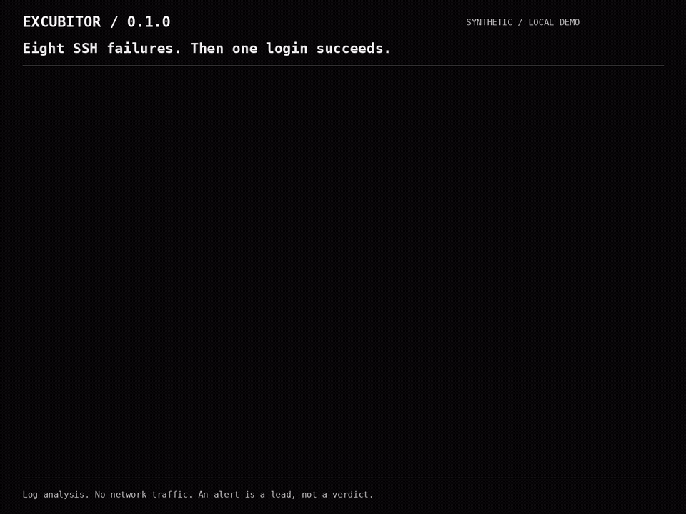

# EXCUBITOR

**Eight failed SSH logins. Then a successful one. What happened?**

Excubitor helps Linux administrators and SOC analysts inspect scan and authentication patterns in a terminal. Each alert shows the source, target, threshold, time window, evidence samples, and a suggested next check.

## Try the local demo

Python 3.11 or later. No installation, runtime dependencies, account, service, or API key. The interactive console uses the standard `curses` module on Linux/macOS.

```bash
git clone https://github.com/artifexignotvs/excubitor.git
cd excubitor
python3 -m excubitor demo
```

The demo replays **93 synthetic events** and emits all nine rules. The replay sends **no network traffic**. On a noninteractive terminal, use `python3 -m excubitor demo --plain`.



[Watch the terminal recording](assets/ssh-investigation.mp4). All addresses and events in this 0.1.0 recording are synthetic. The same alert workflow remains available in 0.2.0.

## Follow one SSH finding

In the demo, the account `operator` fails to authenticate eight times from `192.0.2.30` to `198.51.100.40`, then succeeds. Excubitor emits `auth_success_after_fail` because the failures and the success share an account, source, target, and service within the configured 300-second window.

Press `/`, enter `auth_success_after_fail`, and press Enter to apply the filter. Press Enter again to inspect the selected alert. Review the observed failures, account, source, time window, and suggested next check. For a real finding, compare it with the server's authentication records and confirm whether the login was expected.

A successful login after failures can be legitimate. This alert is an investigation lead, not proof of compromise. For account-specific correlation, use server authentication logs: encrypted SSH sensor observations often have no username.

*Vigilantia ex indiciis.* Vigilance from evidence.

EXCUBITOR is a **log-based detector and investigation console**. It complements Suricata and Zeek. It does not capture packets, inspect payloads, block traffic, or replace an inline IDS/IPS. No comparative superiority or production detection rate is claimed.

## Install the command

To use `excubitor` as a command, install from the checkout in a virtual environment:

```bash
python3 -m venv .venv
. .venv/bin/activate
python -m pip install .
excubitor demo
```

Plain and JSON modes work without `curses`:

```bash
excubitor demo --plain
excubitor demo --jsonl
excubitor demo --db findings.db --output findings.json
```

## Investigation timelines (0.2.0)

Start with the focused SSH scenario, save its alerts, then produce a timeline:

```bash
python3 -m excubitor demo --scenario ssh --plain --output ssh-alerts.json
python3 -m excubitor incidents -i ssh-alerts.json --output-format markdown --output investigation.md
python3 -m excubitor incidents -i ssh-alerts.json --min-alerts 2 --output incident.json
```

The focused demo contains nine synthetic events and two alerts. Timelines retain every alert and its evidence. They group exact IP endpoint pairs, with a maximum 300-second gap and an anchored 900-second span; `--gap` and `--max-span` tune those bounds. Missing or aggregate endpoints remain separate. Shared endpoints and timing do not establish causality, account ownership, or compromise. Overlapping alert counts are never summed into a purported unique event count.

JSON and JSONL alert files are limited to 16 MiB and 10,000 alerts. Input order does not affect results; identical IDs deduplicate and conflicting IDs fail. `--min-alerts` reports how many alerts it omits. The report identifies the input SHA-256 and explicitly treats collection completeness as unknown. Keep collection errors and the original logs alongside it. Exported reports contain evidence and may contain private addresses, paths or account names; review them before sharing.

Filter persisted history before exporting a case:

```bash
excubitor history --db findings.db --source 192.0.2.30 --destination 198.51.100.40 --unacknowledged
excubitor history --db findings.db --severity high --since 1791979200 --until 1791982800
```

Source/destination and severity filters are exact; timestamps are inclusive Unix seconds. All filters apply before the result limit. Acknowledgement means reviewed, not resolved or harmless. Native alert JSON/JSONL can be imported into [Relatio Workbench](https://github.com/artifexignotvs/relatio-workbench) for case notes, triage and encrypted portable backups.

## Follow real logs

Run with read access to the input files. Excubitor never changes them or modifies firewall policy.

```bash
excubitor watch -i /var/log/suricata/eve.json --db findings.db
excubitor watch -i /var/log/auth.log --format auth --year 2026 --db findings.db
excubitor watch -i /var/log/zeek/conn.log -i /var/log/zeek/ssh.log --format zeek
```

The Zeek inputs must use **JSON logging**, not its tab-separated format. Traditional OpenSSH timestamps omit their year and timezone: `--year` supplies the year and this parser interprets them as **UTC**. Prefer timezone-aware ISO timestamps; normalize local-time or year-spanning files before import.

Live mode begins at the current end of each file. Add `--from-start` to consume existing content. Files are followed through rename rotation and observable truncation; partial lines wait for a newline. The old inode is drained before reopening. This is not a lossless collector: copy-truncate followed by rapid regrowth between polls, writes to an old inode after reopening, an unterminated line at rotation, or producer overload can lose coverage. There are no durable read offsets; a restart starts fresh state.

## Investigate and export

| Key | Action |
| --- | --- |
| `j` / `k`, arrows | Select an alert; scroll its detail |
| `Enter` | Open or close evidence and next steps |
| `/` | Search alert fields; empty search clears |
| `h` | Show high/critical severity only |
| `u` | Show unacknowledged alerts only |
| `s` | Toggle severity-first ordering |
| `p` | Freeze the displayed list; ingestion continues |
| `a` | Toggle acknowledgement, persisted when a database is selected |
| `e` | Export retained alerts to a new JSON file in the current directory |
| `q` / `Esc` | Close detail, then quit |

Minimum interactive size: 72 columns by 18 rows; 110 by 30 is more comfortable. Styling follows your terminal's foreground/background colors, with bold and reverse-video emphasis and no color-dependent meaning.

```bash
excubitor analyze -i examples/events.jsonl --tui
excubitor analyze -i eve.json -i auth.jsonl --jsonl > alerts.jsonl
excubitor analyze -i events.jsonl --db findings.db --fail-on-alert
excubitor history --db findings.db --rule password_spray
excubitor history --db findings.db --limit 10000 --output findings.csv --output-format csv
excubitor history --db findings.db --ack ALERT_ID
```

For multiple replay files, **each file must already be time ordered**; Excubitor merges their next events chronologically. It does not sort arbitrary files in memory. Use `-i -` for a single stdin stream. Replaying the same records without unique event IDs can double-count failures; do not feed duplicate sensor observations as separate attempts.

The dashboard and final export retain the latest **1,000 alerts**. `--jsonl` streams every emitted alert. `--db` persists every emitted alert ID, while history queries are explicitly limited (default 1,000, maximum 100,000). The database has no automatic retention policy; monitor disk use. Export files never overwrite existing files. New database/export files use mode `0600` on POSIX; existing permissions are left as supplied. JSON and SQLite are **not encrypted**.

## Detection rules

| Rule | Default trigger | Window |
| --- | --- | --- |
| `vertical_scan` | 20 distinct destination ports, one source/target/protocol | 60 s |
| `horizontal_scan` | 15 destination hosts, one source/port/protocol | 60 s |
| `auth_bruteforce` | 8 failures, same source/target/account-or-unknown/service | 300 s |
| `password_spray` | 6 distinct known accounts failing, one source/target/service | 300 s |
| `distributed_auth` | 5 sources failing against one known account/target/service | 300 s |
| `auth_success_after_fail` | Success after 8 failures, same known account/source/target/service | 300 s |
| `web_path_scan` | 12 distinct paths returning 403/404, same source/target | 60 s |
| `web_denial_burst` | 20 responses returning 401/403, same source/target | 60 s |
| `upstream_alert` | An alert emitted by a supplied sensor | Immediate |

These are **behavioral heuristics**, not verdicts. A scan alert can be an approved scanner or normal service fan-out. Many accounts failing does not prove that the same password was used. A successful login after failures may be legitimate. HTTP failures can come from broken links. Upstream alerts are preserved, not independently verified. HTTP grouping is by IP pair, so virtual hosts sharing an address are combined.

Suricata flow records are observations emitted by a sensor, often after a flow closes. Detection timing follows the **outer log timestamp**, not the first packet. Netflow tuple direction is used as supplied. Zeek SSH authentication results are sensor inferences: missing `auth_success` stays unknown, `auth_attempts` is not expanded into fabricated attempts, and an unknown account cannot support account-specific spray/distributed/success correlation. Unknown-account failures share one source/target/service bucket and may combine different accounts. Use server authentication logs for account-specific evidence.

## Configure and tune

```bash
excubitor config > local.toml
excubitor config --check local.toml
excubitor watch -i eve.json --config local.toml
excubitor rules
```

See [the example configuration](examples/config.toml). Source/destination CIDR allowlists exclude matching events from every rule, including upstream alerts. Disable rules by name. Unknown settings and active-rule thresholds larger than the per-key capacity fail validation. Tune against your own benign traffic before relying on an alert threshold.

Windows use `[event time - window, event time]`, including both boundaries. The greatest accepted event timestamp is the watermark; events more than `allowed_lateness` seconds behind it are dropped and counted. Late observations never rewrite an already issued alert. Future observations are excluded from an earlier event's window. Watch mode rejects timestamps more than 300 seconds ahead of the local clock. Offline replay trusts timestamps; a wrong future timestamp can advance its watermark and discard later input.

Default state bounds: 10,000 detection keys, 512 observations per key, 10,000 explicit-ID deduplication entries, and 10,000 cooldown entries. Capacity eviction is counted and may reduce detection coverage. No per-alert copy of the raw input is retained. The default cooldown is 120 seconds per rule/group. Only explicit native `event_id` values are deduplicated, scoped by input source; flow IDs are not unique event IDs.

The input queue is bounded at 2,048 records, each record at 256 KiB. Malformed, oversized, invalid UTF-8, and excessively late input is visible in counters. Terminal control characters are rejected or neutralized. Query strings, fragments, and URL authorities are discarded; **path segments, usernames, addresses, signatures, and input paths can still be sensitive**. Keep findings local unless you have reviewed them.

Exit codes: `0` completed; `1` alerts with `--fail-on-alert`; `2` invalid configuration, input errors, or rejected late/invalid events; `130` interrupted replay, including quitting interactive replay before EOF. A clean exit does not certify a clean network. Capacity evictions remain visible in the summary even when the exit code is zero. Live `q` or Ctrl-C closes the session and reports its counters.

## Verify and extend

```bash
python3 -m unittest discover -s tests -v
```

Tests cover thresholds, benign traffic, time boundaries, late events, explicit-ID deduplication, bounded state, CIDR exemptions, IPv6, source adapters, file rotation, exports, and command-line workflows. Synthetic tests validate implemented behavior, not detection efficacy against all attacks. On Linux/macOS, a repeatable engine-only throughput exercise is available as `PYTHONPATH=. python3 tests/benchmark.py --profile repeated` (or `--profile many-keys`). It includes event construction, excludes parsing/display/storage, and reports capacity evictions alongside throughput. Its process RSS includes interpreter and runtime overhead; it is not a sensor or packet-rate comparison.

The architecture is intentionally small enough to review: `parsers` normalize records; `engine` correlates bounded event windows; `ingest` reads files; `terminal` presents alerts; `storage` persists/export findings. A typed native JSON schema makes adding an external collector possible without running it inside the detector. [Format examples and schema](FORMATS.md) describe that boundary.

## Help test a real workflow

Run the local demo first. If you administer Linux hosts or investigate alerts in a SOC, the most useful next test is a small, authorized log sample in one of the [supported formats](FORMATS.md). Report parser incompatibilities with the input format and version, a **sanitized or synthetic** record, the command used, the expected result, and the actual result. Remove credentials, private addresses, usernames, hostnames, and paths before opening a public issue. See [the contribution guide](CONTRIBUTING.md) and [security policy](SECURITY.md).

Next work: labeled real-world evaluation with reproducible false-positive measurements, durable collector checkpoints, more authentication adapters, and performance profiling under realistic mixed traffic. Packet capture, inline response, and threat-intelligence feeds are outside this release.

Maintained by **Artifex Ignotvs**. MIT licensed.
